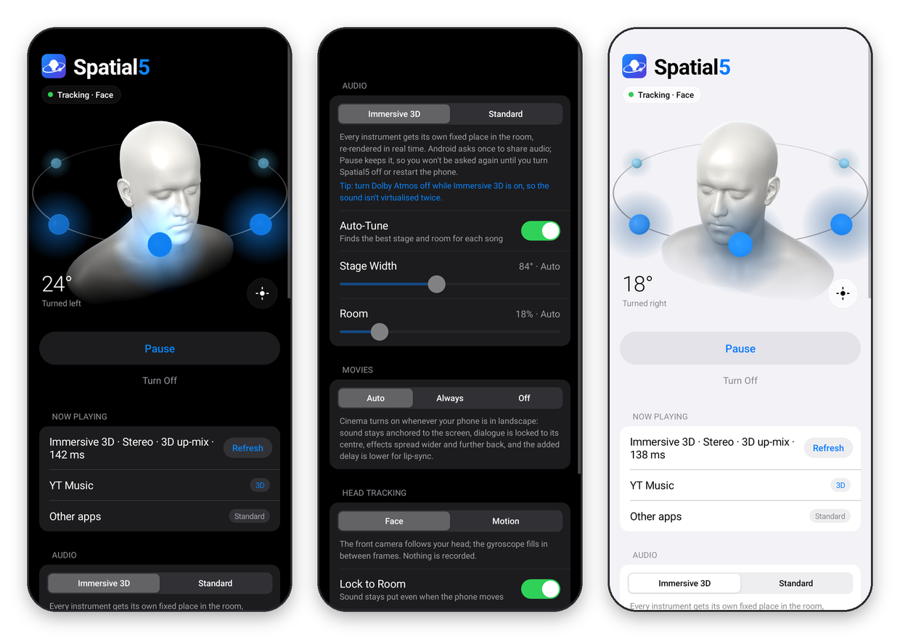
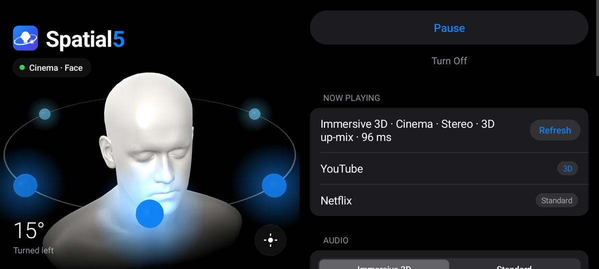

# Spatial5

Head-tracked spatial audio for Android earbuds that don't have head tracking.

I have a pair of Soundcore P30i earbuds and a phone with Dolby Atmos, and I missed the effect
AirPods have where the music stays put when you turn your head. The earbuds have no motion sensors,
so Spatial5 follows your head with the phone's front camera (or the phone's own motion sensors),
then re-renders whatever is playing so every instrument keeps a fixed place in the room.

It runs in the background and works with the players you already use.

<p align="center">
  
</p>

## How it works

**Tracking.** ML Kit's face detector runs on small front-camera frames and gives the angle of your
head relative to the phone. Adding the phone's gyroscope heading turns that into your head's
direction in the room, so the sound stays fixed even if the phone moves. A One Euro filter and a
little velocity prediction keep it smooth, and the Bluetooth delay is measured and predicted away,
so the sound is rendered for where your head will be when it reaches your ears. If you'd rather not
use the camera, *Motion* mode uses only the phone's sensors (phone in your pocket).

**Immersive 3D.** The player's audio is captured with Android's playback-capture API, the original
is muted with an audio effect on its session, and Spatial5 plays its own binaural render:

- stereo is split up in short frequency bands. The parts that are panned somewhere become sources
  at that spot on a virtual stage; reverb and wide content become ambience to the sides and behind
  you;
- 5.1 / 7.1 audio is rendered as virtual speakers;
- each source goes through measured head-related transfer functions (MIT's KEMAR set) at its
  angle minus your head's angle, with the correct timing difference between the ears;
- a small virtual room with direction-aware reflections pushes the sound out of your head;
- the tone is matched to the original song (a slow, smoothed EQ learned while you face forward),
  and the bass passes through untouched, so it doesn't get muddy.

*Auto-Tune* adjusts the stage width and the amount of room to each song: dry recordings get more
room, reverberant or bass-heavy ones get less.

**Standard.** For apps that can't be captured (Netflix and other DRM-protected apps block it), or
when you don't want the capture prompt, Spatial5 changes the balance and tone of each ear in place.
It's lighter than Immersive 3D, adds no delay, and works best with Dolby Atmos left on.

**Movies.** In landscape, Spatial5 switches to a cinema profile: the sound is anchored to the
screen rather than the room, dialogue is pinned to the centre of the screen, effects spread wider
and further back, and the output buffer is kept small to help lip-sync. You can also force it on or
off.

<p align="center">
  
</p>

## Install

Download the APK from [Releases](../../releases) and install it. You'll need Android 10 or newer and
Google Play services (ML Kit uses it for the face model).

1. Open Spatial5 and tap **Start Head Tracking**. Allow the camera and notifications.
2. Android asks to share your screen. Pick **Entire screen**. Only the audio is used; nothing is
   recorded and nothing leaves the phone. **Pause** keeps this permission, so you only see the
   prompt again after **Turn Off** or a reboot.
3. Turn off Dolby Atmos (or any other spatial effect) in the phone's sound settings while you use
   Immersive 3D, otherwise the sound gets virtualised twice. Leave it on for Standard.
4. Play something. *Now Playing* shows each app as **3D** or **Standard**.

Players that announce their audio session (YouTube Music, for example, and many apps built on
Media3/ExoPlayer) switch to 3D straight away. For the others Spatial5 scans the most recent audio sessions, then works out which
app is playing with a few very short test captures, which takes a few seconds. **Refresh** in Now
Playing retries immediately.

## Permissions

| Permission | Why |
|---|---|
| Camera | Face tracking. Frames are processed in memory and never stored. |
| Record audio + screen capture | Android's playback capture, used to re-render other apps' audio. The microphone is not used. |
| Query all packages | To find which installed app owns the audio being played. |
| Modify audio settings | Muting a player's original output and the Standard mode effect. |
| Foreground service, notifications | Running in the background with a persistent notification. |

The app has no internet permission at all (the one ML Kit's libraries request for usage logging
is removed), so nothing it sees or hears can leave the phone.

## Limitations

- Apps that forbid audio capture can only get Standard. Android gives no way around that without
  root.
- Only left/right head turns are tracked; height in Atmos mixes isn't reproduced.
- The HRTFs are from a dummy head, not your own ears, so front/back cues are generic. Head tracking
  is what resolves most of the front/back confusion.
- Face tracking needs to see you. In a very dark room the camera may not get enough light; switch to
  Motion in that case.
- Immersive 3D adds a little delay, mostly hidden by head prediction. For films where lip-sync
  matters, Standard adds none.
- Tested on one phone so far (Xiaomi, Android 16). Reports from other devices are welcome; the
  Diagnostics panel under Advanced has a Copy button that's useful in an issue.

## Building

```
./gradlew assembleRelease
```

The APK ends up in `app/build/outputs/apk/release/`. Without a signing key the release build is
signed with your local debug key, which is fine for trying it out. Unit tests (`./gradlew
testDebugUnitTest`) cover the renderer (direction, timing between the ears, tone match, distortion,
clicks), the tracking filters and the low-light image path. One of them writes a short demo file to
`app/build/demo/head_tracking_demo.wav` that you can listen to on headphones.

`tools/` has the scripts that turned the KEMAR measurements and the head scan into the small binary
assets in `app/src/main/assets/`.

### Releases

Pushing a tag like `v1.2` runs `.github/workflows/release.yml`, which builds a signed APK and
attaches it to a GitHub release. It needs two repository secrets:

- `KEYSTORE_BASE64`: the release keystore, base64-encoded (`base64 -w0 release.jks`)
- `KEYSTORE_PASSWORD`: its password (used for the key too)

and optionally `KEY_ALIAS` (defaults to `spatial5`). Keep the keystore itself out of the
repository: every release must be signed with the same key, or Android won't install it as an
update.

## Project layout

```
app/src/main/java/dev/spatial5/
  tracking/   face and motion tracking, head-pose fusion, low-light handling
  dsp/        FFT, HRTF table, binaural renderer, virtual room
  audio/      capture/playback engine, per-app effects, session discovery
  ui/         3D head view, segmented control, springs
  TrackerService.kt   the foreground service that ties it together
```

## Credits

- HRTF data: Bill Gardner and Keith Martin, MIT Media Lab, *HRTF Measurements of a KEMAR Dummy-Head
  Microphone* (1994).
- Head model: "Lee Perry-Smith" scan by Infinite Realities, CC BY 3.0, via the three.js examples.
- Face detection: Google ML Kit.

Details are in [THIRD_PARTY_NOTICES.md](THIRD_PARTY_NOTICES.md).

## License

MIT. See [LICENSE](LICENSE). The bundled HRTF data and head model have their own terms, listed in
the notices file.
